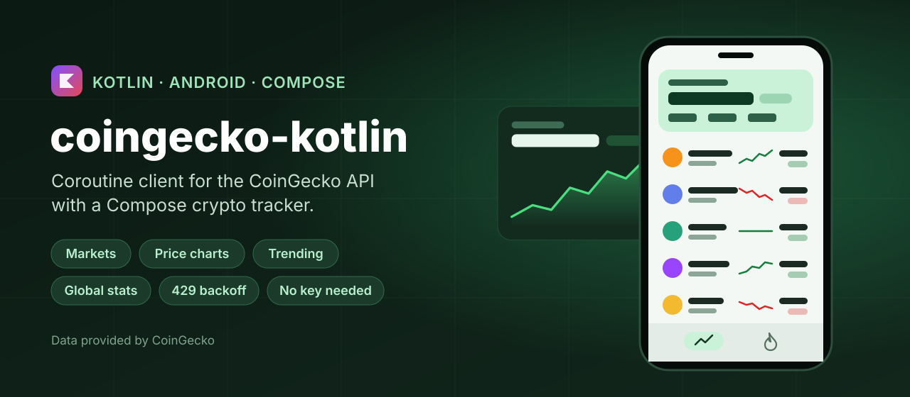
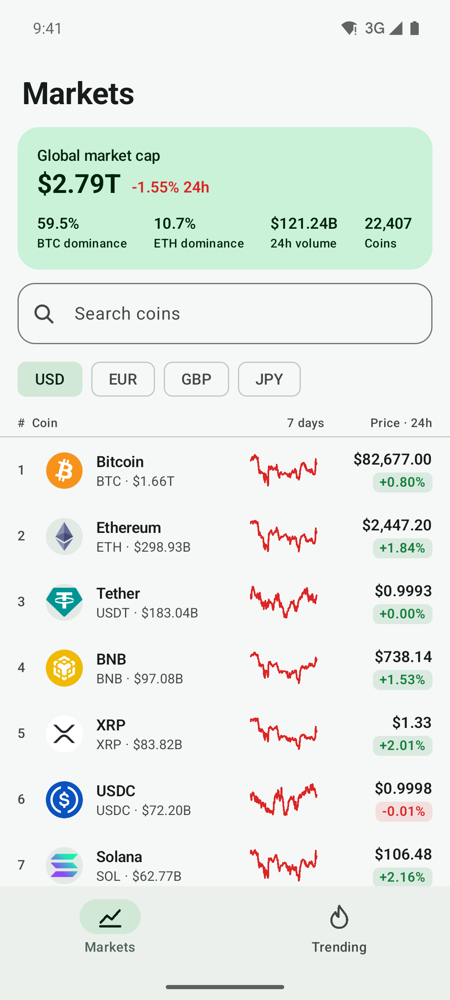
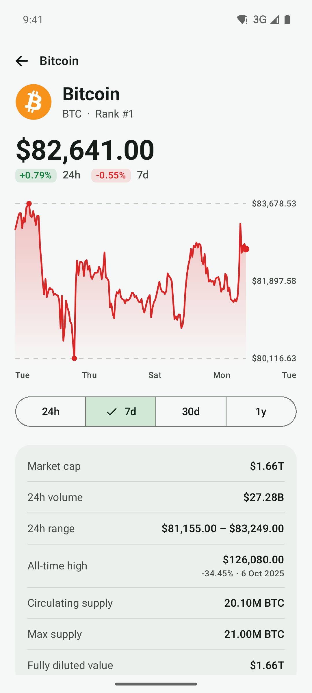
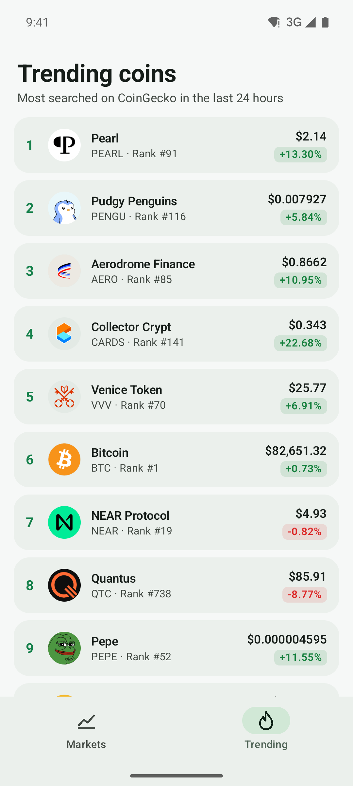

<p align="center">
  
</p>

<p align="center">
  <a href="https://github.com/halilozel1903/coingecko-kotlin/actions/workflows/ci.yml"></a>
  <a href="https://jitpack.io/#halilozel1903/coingecko-kotlin"></a>
  
  
  
  
  
  <a href="LICENSE"></a>
</p>

**coingecko-kotlin** is a Kotlin client for the [CoinGecko API](https://www.coingecko.com/en/api) (v3). It covers simple prices, the markets list with sparklines, coin details, price charts, search, trending coins and global market data, with typed models for every response. It works on the free **keyless** public tier out of the box, takes an optional Demo or Pro key, and retries rate limited requests (HTTP 429) after the wait the `Retry-After` header asks for. The client is pure Kotlin/JVM (Ktor, kotlinx.serialization, coroutines), so it runs on Android, on the server and in tests. The sample app is a Compose crypto tracker for phones.

> **Data provided by [CoinGecko](https://www.coingecko.com/en/api).** This project is not affiliated with or endorsed by CoinGecko.
>
> **Not financial advice.** Prices and statistics are shown for information only and may be delayed or wrong. Nothing in this library or its sample app is a recommendation to buy, sell or hold any asset.

```kotlin
val client = CoinGeckoClient()                                   // keyless public tier

val top = client.markets {
    vsCurrency = "usd"
    perPage = 20
    sparkline = true
    priceChange(PriceChangeWindow.Hour, PriceChangeWindow.Week)
}
top.first().name                                                  // "Bitcoin"
top.first().sparkline7d?.points                                   // ~168 hourly prices

val btc = client.coin("bitcoin")                                  // trimmed: market data + English description
btc.marketData?.price("eur")
val week = client.marketChart("bitcoin", vsCurrency = "usd", days = 7)
client.global().btcDominance                                      // e.g. 58.4
client.trending().coins.map { it.name }
```

## Screenshots

Captured live from the keyless CoinGecko API by CI, with the sample app on an Android emulator. Prices, charts, logos, trending coins and global numbers are real data loaded from api.coingecko.com and CoinGecko's image CDN during the run, so they change every time CI runs. There is no fallback data: if CoinGecko refuses or rate limits the runner, the screenshot step fails instead.

| Markets with the global header | Bitcoin, 7 day chart and stats | Trending coins |
| :---: | :---: | :---: |
|  |  |  |

## Features

- **Every endpoint of the free tier an app needs**: ping, simple price, markets, coin details, market chart, search, trending and global.
- **Typed models**: `MarketCoin` with `Sparkline` and `Roi`, `CoinDetail` with `CoinMarketData`, `CoinLinks` and `CoinImage`, `MarketChart` of `ChartPoint`s, `SearchResult`, `Trending`, `GlobalData` and `SimplePrice`. Unknown fields are ignored, nulls fall back to defaults, and values the API sends as numbers or formatted text (`"$1,234"`) are read either way.
- **Typed queries**: `MarketsQuery` (vs currency, ids, category, order, page size, page, sparkline, price change windows, precision), `CoinOptions` with trimmed flags by default, `ChartDays` and `ChartInterval`. Invalid values are rejected before a request is sent.
- **Rate limits handled politely**: `RetryPolicy` retries 429, 5xx and network errors, waits exactly as long as `Retry-After` asks (seconds or an HTTP date), and gives up at once with `CoinGeckoException.RateLimited` when the server asks for longer than a minute. Without the header it backs off exponentially with jitter.
- **No key required, keys supported**: a Demo key is sent as `x-cg-demo-api-key`; a Pro key is sent as `x-cg-pro-api-key` and switches to `pro-api.coingecko.com`.
- **Helpers**: per-currency accessors (`price("eur")`, `marketCap("usd")`, `change7d("usd")`), `btcDominance`, `descriptionText` (HTML stripped), `homepage`, `minPrice` / `maxPrice` / `changePercentage` of a chart, and `Instant`s for dates.
- **Coroutines**: main-safe `suspend` functions that throw a `CoinGeckoException` (`NotFound`, `RateLimited`, `Http` with status, body and the API's error message, `Network`, `Decoding`).
- **Pluggable HTTP**: Ktor with CIO by default; pass OkHttp, Android, Java or a `MockEngine`, a ready `HttpClient`, or your own `CoinGeckoTransport`.
- **Explicit API**, unit tested against JSON fixtures in the v3 response shapes, including the retry timing.

### API coverage

| Endpoint | Function | Returns |
| --- | --- | --- |
| `GET /ping` | `ping()` | `Ping` |
| `GET /simple/price` | `simplePrice(ids, vsCurrencies, includeMarketCap, include24hVolume, include24hChange, includeLastUpdatedAt, precision)`, `price(id, vsCurrency)` | `Map<String, SimplePrice>`, `Double?` |
| `GET /coins/markets` | `markets(query)`, `markets { ... }` | `List<MarketCoin>` |
| `GET /coins/{id}` | `coin(id, options = CoinOptions())` | `CoinDetail` |
| `GET /coins/{id}/market_chart` | `marketChart(id, vsCurrency, days, interval, precision)`, `marketChart(id, vsCurrency, days: Int)` | `MarketChart` |
| `GET /search` | `search(query)` | `SearchResult` |
| `GET /search/trending` | `trending()` | `Trending` |
| `GET /global` | `global()` | `GlobalData` |
| Any url | `fetch(url, deserializer)`, `url(path, parameters)` | `T`, `String` |

### `/coins/markets` parameters

| `MarketsQuery` property | Parameter | Default |
| --- | --- | --- |
| `vsCurrency` | `vs_currency` | `usd` |
| `ids` / `ids("a", "b")` | `ids` | all coins |
| `category` | `category` | none |
| `order` (`MarketOrder`) | `order` | `market_cap_desc` |
| `perPage` (1 to 250) | `per_page` | `100` |
| `page` | `page` | `1` |
| `sparkline` | `sparkline` | `false` |
| `priceChangePercentage` / `priceChange(...)` (`PriceChangeWindow`) | `price_change_percentage` | none |
| `precision` (`"0"` to `"18"`, `"full"`) | `precision` | API default |

### `/coins/{id}` flags

`CoinOptions()` sends `localization=false&tickers=false&market_data=true&community_data=false&developer_data=false&sparkline=false`: market data and the English description, without the parts that make the response many times larger. Turn any of them on, or use `CoinOptions.Full`.

## Installation

Add JitPack to `settings.gradle.kts`:

```kotlin
dependencyResolutionManagement {
    repositories {
        google()
        mavenCentral()
        maven("https://jitpack.io")
    }
}
```

Then the dependency:

```kotlin
dependencies {
    implementation("com.github.halilozel1903.coingecko-kotlin:coingecko:1.0.0")

    // Optional: use OkHttp instead of Ktor's CIO engine.
    implementation("io.ktor:ktor-client-okhttp:3.6.0")
}
```

> The build is also set up for Maven Central (`io.github.halilozel1903:coingecko`) via the vanniktech publish plugin.

`coingecko` is a plain Kotlin/JVM library (JDK 17+). On Android, the `Instant` helpers use `java.time`, which needs API 26 or core library desugaring; everything else works on any API level.

## Usage

**Create a client**

```kotlin
val client = CoinGeckoClient {
    engine = OkHttp.create()                       // default: CIO
    userAgent = "my-tracker/1.0 (+https://example.com)"
    requestTimeoutMillis = 15_000
}
// ...
client.close()
```

Create one client and share it; it is safe to use from many coroutines.

**API keys (optional)**

No key is needed. The keyless public tier has a low rate limit that is shared by everyone behind the same IP address. With a free [Demo key](https://www.coingecko.com/en/api/pricing) you get a stable limit of your own; a Pro key unlocks the paid API:

```kotlin
val demo = CoinGeckoClient { demoApiKey = "CG-..." }   // header x-cg-demo-api-key, api.coingecko.com
val pro = CoinGeckoClient { proApiKey = "CG-..." }     // header x-cg-pro-api-key, pro-api.coingecko.com
demo.plan                                              // ApiPlan.Demo
```

Keep keys out of source control; read them from your build configuration or a secrets store.

**Rate limits and retries**

```kotlin
val client = CoinGeckoClient {
    retryPolicy = RetryPolicy(
        maxRetries = 3,               // after the first attempt
        initialDelayMillis = 2_000,   // backoff without Retry-After: 2 s, 4 s, 8 s ... plus jitter
        maxDelayMillis = 60_000,      // never wait longer than this; a longer Retry-After fails at once
        respectRetryAfter = true,
    )
}

try {
    client.markets()
} catch (e: CoinGeckoException.RateLimited) {
    e.retryAfterMillis                // the wait CoinGecko asked for, if it sent Retry-After
}
```

Use `RetryPolicy.None` to fail immediately. 400, 401, 403 and 404 are never retried.

**Prices**

```kotlin
val prices = client.simplePrice(
    ids = listOf("bitcoin", "ethereum"),
    vsCurrencies = listOf("usd", "eur"),
    includeMarketCap = true,
    include24hChange = true,
)
prices.getValue("bitcoin").price("usd")
prices.getValue("ethereum").change24h("eur")

client.price("solana", "usd")                  // one number
```

**Markets**

```kotlin
val page2 = client.markets {
    vsCurrency = "eur"
    order = MarketOrder.VolumeDesc
    perPage = 50
    page = 2
    sparkline = true
    priceChange(PriceChangeWindow.Hour, PriceChangeWindow.Day, PriceChangeWindow.Week)
}
val coin = page2.first()
coin.currentPrice
coin.priceChangePercentage(PriceChangeWindow.Week)
coin.sparkline7d?.points
coin.image                                     // logo on CoinGecko's image CDN

client.markets { ids("bitcoin", "ethereum"); vsCurrency = "jpy" }
client.markets { category = "layer-1" }
```

**Coin details and charts**

```kotlin
val btc = client.coin("bitcoin")
btc.descriptionText                            // plain text, HTML removed
btc.homepage
btc.marketData?.ath("usd")
btc.marketData?.athInstant("usd")
btc.marketData?.change30d("usd")

val chart = client.marketChart("bitcoin", "usd", ChartDays.Week)
chart.prices                                   // List<ChartPoint(timeMillis, value)>, hourly for 7 days
chart.maxPrice
chart.changePercentage
client.marketChart("ethereum", "usd", ChartDays.Year, interval = ChartInterval.Daily)
```

**Search, trending and global**

```kotlin
client.search("doge").coins.map { it.id }      // ["dogecoin", ...]

val trending = client.trending()
trending.coins.first().priceUsd
trending.coins.first().change24hUsd
trending.categories.map { it.name }

val global = client.global()
global.totalMarketCap("usd")
global.btcDominance
global.marketCapChangePercentage24hUsd
```

**Errors**

```kotlin
try {
    client.coin("no-such-coin")
} catch (e: CoinGeckoException.NotFound) {
    // unknown coin id
} catch (e: CoinGeckoException.RateLimited) {
    // still 429 after the retries, or Retry-After longer than the policy allows
} catch (e: CoinGeckoException.Http) {
    // e.status, e.errorMessage: 401 for a bad key, 403 when refused, 5xx after retries
} catch (e: CoinGeckoException.Network) {
    // offline or timed out
}
```

**Testing your code**

Pass a Ktor `MockEngine` as `engine`, as this library's own tests do, or replace HTTP entirely:

```kotlin
val client = CoinGeckoClient {
    transport = CoinGeckoTransport { url -> fixtures.getValue(url) }
}
```

## Sample app

The `sample` module is a crypto tracker for phones:

- **Markets**: a global header (total market cap with its 24 hour change, BTC and ETH dominance, 24 hour volume, number of coins), a coin search, USD / EUR / GBP / JPY chips and the market list with real coin logos, price, 24 hour change and a 7 day sparkline. More pages load as you scroll.
- **Coin detail**: logo, price, 24 hour and range change, a price chart (24h, 7d, 30d, 1y; 7 days to start with) that you can touch to read a point, market cap, volume, 24 hour range, all-time high, supply, the change over 1h to 1y, and the description.
- **Trending**: the coins searched most on CoinGecko in the last 24 hours, and the trending categories.

Every screen shows "Data provided by CoinGecko" with a link. Data is loaded only when a screen is shown, to keep the number of calls to the keyless tier low.

For screenshots it opens a fixed screen from an intent extra (used by `scripts/screenshots.sh`):

```bash
./gradlew :sample:installDebug
adb shell am start -n io.github.halilozel1903.coingecko.sample/.MainActivity --es scene detail
```

`scene` is one of `markets` (two calls: `/global` and one page of `/coins/markets`), `detail` (two calls: `/coins/bitcoin` and its 7 day chart) or `trending` (one call). Scenes load live data through the same client as a normal launch, with a slower and longer `RetryPolicy`, and log `SCENE_READY` once the data and every logo on screen have loaded. CI captures them on a Pixel 7, pauses between scenes, and fails instead of capturing when a scene shows an error (CoinGecko refusing or rate limiting the runner included), does not finish loading, misses the expected text or is blank. There is no offline or demo data in the sample.

The sample is keyless. To build it with a Demo key, set `COINGECKO_DEMO_API_KEY` in the environment; CI passes a repository secret of that name if one exists.

## Project structure

| Module | What it is |
| --- | --- |
| `coingecko` | Pure Kotlin/JVM: `CoinGeckoClient`, queries, `RetryPolicy`, models. Published as `coingecko` |
| `sample` | The Compose crypto tracker, with screenshot scenes |

## Tech stack

Kotlin 2.4 · Ktor 3.6 (CIO, OkHttp) · kotlinx.serialization · kotlinx.coroutines · AGP 9.4 with built-in Kotlin · Gradle 9.6 · Jetpack Compose (BOM 2026.09) · Material 3 · Coil 3 (sample) · GitHub Actions with Android emulators

## Data source and attribution

All market data comes from the [CoinGecko API](https://www.coingecko.com/en/api). As CoinGecko's terms ask, apps that show it should credit it; the sample shows "Data provided by CoinGecko" with a link to CoinGecko on every screen, and you should do the same in your app. Coin names, logos and descriptions belong to their owners and to CoinGecko. Check CoinGecko's [API terms](https://www.coingecko.com/en/api_terms) and rate limits before you ship; the keyless tier is meant for light use, and a free Demo key is the better choice for an app with real users. This project is not affiliated with CoinGecko.

Nothing here is financial advice.

## License

MIT. See [LICENSE](LICENSE).
